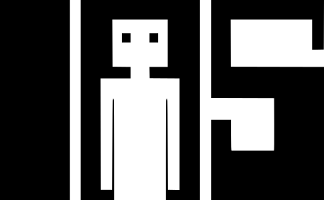
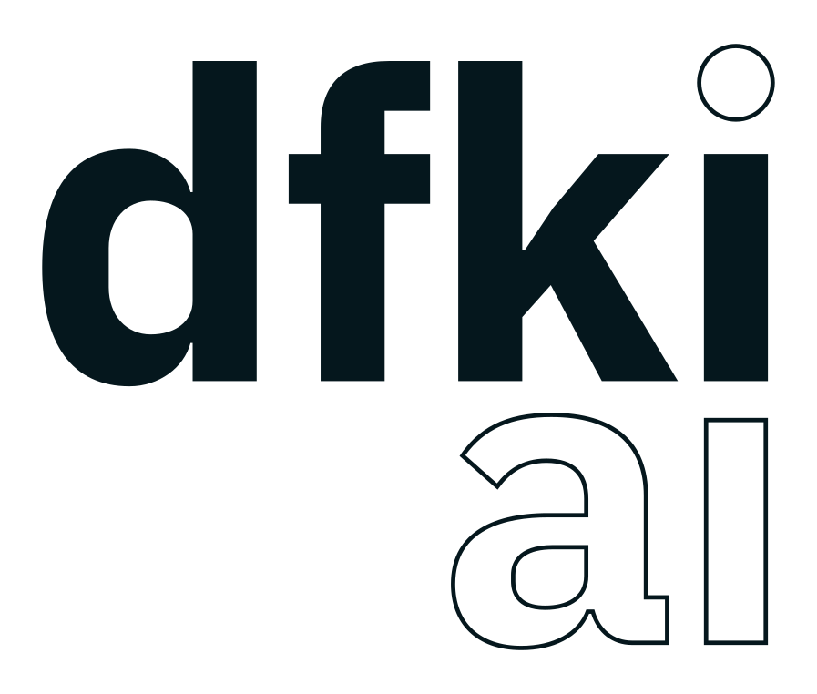
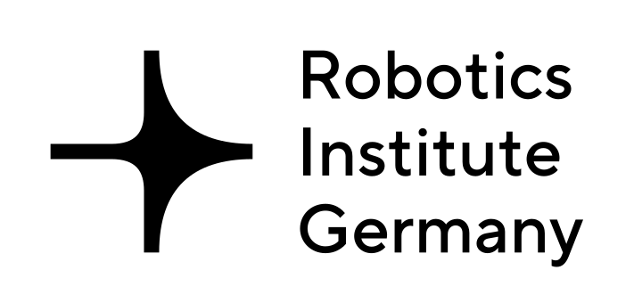
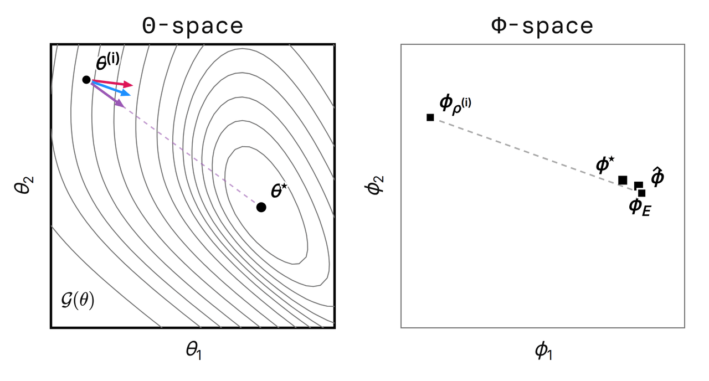

<span>
  &nbsp;&nbsp;
  &nbsp;&nbsp;
  &nbsp;&nbsp;
  &nbsp;&nbsp;
  
  &nbsp;&nbsp;
</span>
<br clear="all">

[[`Webpage`](https://anishhdiwan.github.io/geometric-perspective/)] [[`Paper`](https://arxiv.org/pdf/)] <br>
Official code release for our **NeurIPS 2026** paper :page_facing_up:<br>
<big><strong>A Geometric Perspective on Reward Function Updates in Inverse Reinforcement Learning</strong></big><br>
<em><a href="https://anishhdiwan.github.io/">Anish Diwan</a>, <a href="https://www.ias.tu-darmstadt.de/Team/JanPeters">Jan Peters</a>, <a href="https://www.ias.informatik.tu-darmstadt.de/Team/OlegArenz">Oleg Arenz</a></em>

<strong>TL;DR</strong>&ensp;IRL can be decoupled into a policy-side and a reward-side optimization problem, where the policy objective is to minimize the KL divergence to the expert and the reward objective is to minimize the IRL problem's Lagrangian dual. The reward problem is classically solved with gradient descent, which is slow. We instead show that it can be easily solved with natural gradient descent. Our key insight is that the natural gradient of the Lagrangian dual is easily computable just as a convex interpolation of the previous reward and an empirical estimate of the optimal reward (i.e. no need to estimate, compute, or invert any FIM). We show that this update is equivalent to mirror descent (MD), and policy search over this reward is approximate entropic MD with bounded errors in the trust-region setting.

<p align="center">
  
  <br>
  <em>An illustration of the cheap and efficient natural-gradient-like reward function updates proposed in this paper. Unlike gradient updates (red), the proposed update (blue) is curvature-aware and closer to the ideal (direct) optimization direction (purple).</em>
</p>


### Install & Run
```bash
./install.sh
```

### Cite

```bibtex
@inproceedings{diwan2026geometric,
  title     = {A Geometric Perspective on Reward Function Updates in Inverse Reinforcement Learning},
  author    = {Diwan, Anish and Peters, Jan and Arenz, Oleg},
  booktitle = {Advances in Neural Information Processing Systems (NeurIPS)},
  year      = {2026},
  url={https://openreview.net/pdf?id=oqLzCT1cus}
}
```